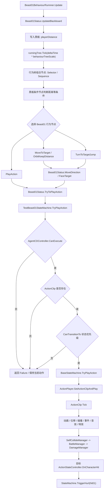

# 怪物行为树与 ActionStateController 流程图

本文说明 Beast01 怪物当前的行为树如何和 `ActionStateController`、状态机、`ActionPlayer` 混合工作。


## 核心流程

```text
Beast01BehaviourRunnner.Update
-> Beast01Status.UpdateBlackboard
-> BehaviourTree.Tick
-> 条件节点读取 playerDistance
-> Beast01 专用行为节点决定移动、转向、攻击
-> Beast01Status 作为桥接层调用状态机
-> TestBeast01StateMachine 检查 CD、状态优先级、动作资源
-> BaseStateMachine / ActionPlayer 播放 ActionClip
-> ActionClip 驱动动画、碰撞、事件、音效、特效
-> 命中后进入伤害系统
-> 受击目标 OnCharacterHit，再由状态机尝试切受击动作
```

## Mermaid 版本



## 关键边界

- 行为树负责决策，不直接执行底层动画、碰撞和伤害。
- `Beast01Status` 是行为树和角色控制器之间的桥。
- `TestBeast01StateMachine` 负责怪物动作 CD、状态切换合法性和自动回 idle。
- `ActionStateController` 和 `ActionPlayer` 负责真正执行 ActionClip。
- 受击不由行为树主动处理，而是伤害系统回调 `OnCharacterHit` 后，由状态机尝试切到 `hit01`。

