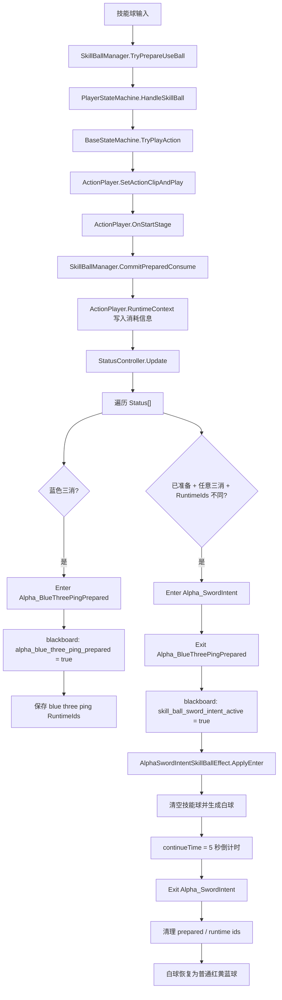

# StatusController 与 Alpha 状态流程

本文说明当前项目中 `StatusController` 如何根据黑板条件和运行时触发器进入不同状态，以及 Alpha 角色如何用它实现“蓝三消准备 -> 剑意状态”。


## 通用 StatusController 流程

```text
StatusController.Update
  -> TryBindRunningBlackboard()
  -> CheckStatusConditions()
  -> 遍历 Status[]
  -> 检查 BlackboardCondition
  -> 检查 StatusTrigger
  -> EnterStatus / ExitStatus
  -> TickActiveStatuses
  -> continueTime 到期自动退出
```

进入状态时：

```text
EnterStatus(status)
  -> activeStatusTimers[status] = status.continueTime
  -> RunningBlackboard[activeBoolKey] = true
  -> StatusEventListener.OnStatusEntered
```

退出状态时：

```text
ExitStatus(status)
  -> 从 activeStatusTimers 移除
  -> RunningBlackboard[activeBoolKey] = false
  -> 应用 exitBlackboardWrites
  -> StatusEventListener.OnStatusExited
```

## Alpha 当前状态链

```text
技能球动作进入 Start 阶段
  -> SkillBallManager.CommitPreparedConsume()
  -> 写入 ActionPlayer.RuntimeContext
  -> StatusController.Update()
  -> SkillBallConsumeStatusTrigger 检查蓝三消
  -> 进入 Alpha_BlueThreePingPrepared
  -> 写入 alpha_blue_three_ping_prepared = true
  -> AlphaSwordIntentStatusListener 保存本次蓝三消 RuntimeIds

之后再次任意三消
  -> AlphaAnyThreePingAfterBluePreparedTrigger 检查准备状态和 RuntimeIds
  -> 进入 Alpha_SwordIntent
  -> 退出 Alpha_BlueThreePingPrepared
  -> 写入 skill_ball_sword_intent_active = true
  -> AlphaSwordIntentSkillBallEffect 替换技能球为白球
  -> 5 秒后自动退出
  -> 清理 prepared 标记和 RuntimeIds
  -> 白球恢复为普通红/黄/蓝球
```

## 关键配置

- `Alpha_BlueThreePingPrepared`：蓝三消后进入，`continueTime = 0`，不会自动倒计时退出。
- `Alpha_SwordIntent`：准备状态下再次任意三消进入，`continueTime = 5`。
- `alpha_blue_three_ping_prepared`：记录是否已有蓝三消准备。
- `alpha_blue_three_ping_runtime_ids`：记录准备阶段消耗的球，避免同一次消耗重复触发。
- `skill_ball_sword_intent_active`：剑意是否激活，生成技能球时会影响 `AlphaSkillBallSpawnProvider`。

## Mermaid 版本



