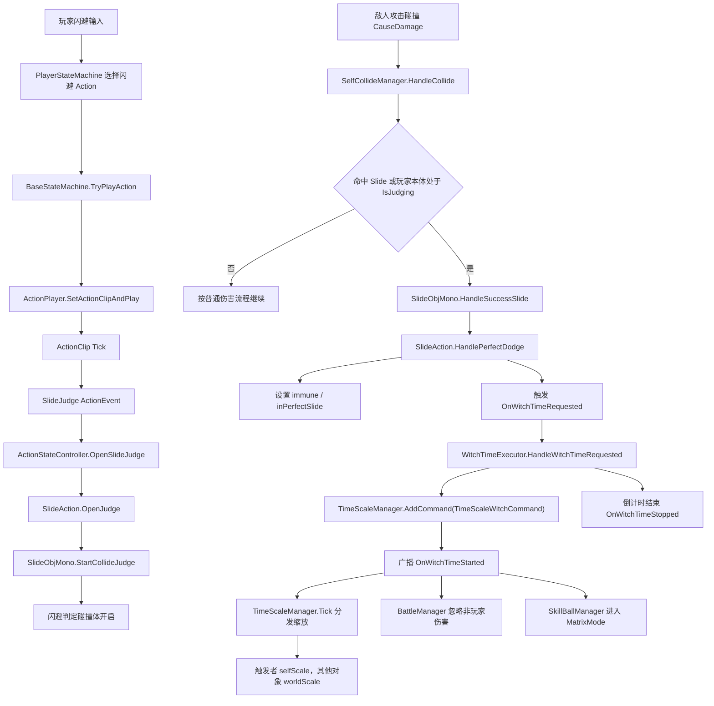

# 魔女时间（超算空间）触发流程

本文说明当前项目中魔女时间如何由完美闪避触发，并如何影响时间缩放、伤害过滤和技能球矩阵模式。


## 触发主链路

```text
玩家输入闪避
  -> PlayerStateMachine.TryPlayAction(slide_front / slide_behind)
  -> BaseStateMachine.TryPlayAction(...)
  -> ActionPlayer.SetActionClipAndPlay(...)
  -> ActionClip 驱动动画 / 碰撞 / 事件 / 音效 / 特效
  -> ActionEventDispatcher.Dispatch(SlideJudge)
  -> SlideJudgeEventHandler
  -> ActionStateController.OpenSlideJudge()
  -> SlideAction.OpenJudge()
  -> SlideObjMono.StartCollideJudge()
  -> 闪避判定碰撞体开启
```

敌人攻击命中玩家闪避窗口时：

```text
敌人 ActionClip 碰撞检测
  -> SelfCollideManager.HandleCollide(sliceId, collider)
  -> 命中玩家 Slide 碰撞体，或命中玩家本体时发现玩家 SlideObjMono.IsJudging
  -> SelfCollideManager.HandleSlideCollide / TryTriggerPerfectDodgeFromTarget
  -> SlideObjMono.HandleSuccessSlide()
  -> SlideObjMono.OnSuccessSlide
  -> SlideAction.HandlePerfectDodge(...)
  -> 设置玩家 immune = true，PlayerProperty.inPerfectSlide = true
  -> GameApplication.EventCenter.TriggerEvent(OnWitchTimeRequested, WitchTimeRequest)
```

魔女时间执行：

```text
WitchTimeExecutor.HandleWitchTimeRequested(...)
  -> 校验 request.IsValid
  -> 若已有魔女时间，根据 playPolicy 处理
  -> StartWitchTime(...)
  -> TimeScaleManager.AddCommand(TimeScaleWitchCommand)
  -> 广播 OnWitchTimeStarted
  -> Update 中倒计时
  -> 到时 FinishWitchTime()
  -> 广播 OnWitchTimeStopped
```

时间缩放落地：

```text
TimeScaleManager.Tick(...)
  -> witchMode.Update(deltaTime)
  -> 遍历所有 ITimeScaleDispatcher
  -> TimeScaleWitchCommand.Execute(...)
  -> casterId 对应的 Dispatcher 使用 selfScale
  -> 其他 Dispatcher 使用 worldScale
  -> dispatcher.ApplyScale(TimeScaleType, finalScale)
  -> ActionPlayer / CollideAbility / BulletAbility / AudioAbility / ParticleAbility 等模块响应 TimeScaleChanged
```

## 当前配置点

魔女时间参数来自 `SlideConfigSo`：

- `enablePerfectDodgeWitchTime`：是否允许完美闪避触发魔女时间。
- `witchTimeDuration`：持续时间。
- `witchSlowScale`：其他对象的时间缩放。
- `witchSelfScale`：触发者自身时间缩放。
- `witchCooldown`：完美闪避再次触发魔女时间的冷却。
- `witchAffectedType`：影响的时间类型，默认可影响 `Bullet / Effect / Audio / Logic`。

## 当前额外影响

- `BattleManager` 监听 `OnWitchTimeStarted / OnWitchTimeStopped`，魔女时间期间会忽略非玩家攻击者造成的伤害。
- `SkillBallManager` 监听同样事件，若事件的 `casterId` 等于自身角色 ID，则进入 `MatrixMode`。
- UI 的 `ActionUISkillBallRuntimeBinder` 也监听魔女时间事件，用于通知技能球 UI 切换矩阵表现。
- `SlideAction.StopCollideJudge()` 会关闭判定窗口，并清除完美闪避期间设置的 `immune` 和 `inPerfectSlide`。

## 关键边界

- 魔女时间的触发条件不是“按下闪避”，而是“闪避动作打开判定窗口后，敌方 CauseDamage 碰撞与玩家闪避判定成立”。
- `SlideObjMono.HandleSuccessSlide()` 每次判定窗口只会触发一次成功，避免同一次闪避重复触发。
- `WitchTimeExecutor` 只负责接收请求、创建时间缩放命令和广播生命周期事件。
- 真正的减速效果由 `TimeScaleManager` 分发到已注册的 `ITimeScaleDispatcher`。
- 目前 `BattleManager` 的伤害过滤是全局 `isWitchTimeActive`，不是按 `casterId` 精确区分。

## Mermaid 版本



