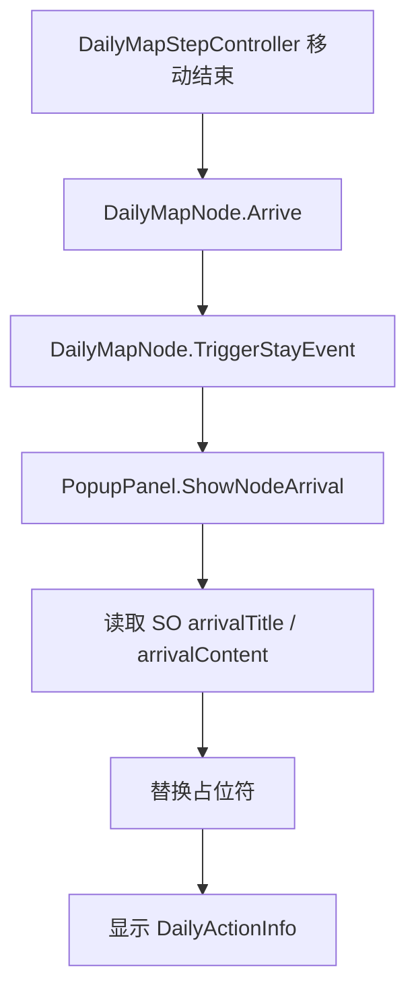
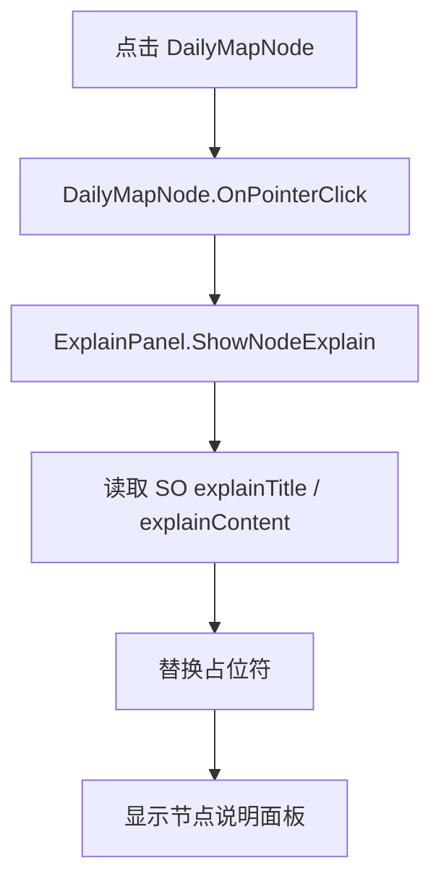

# DailyClickCloseInfoPanel 拆分修订方案

## 目标

将当前 `DailyClickCloseInfoPanel` 拆分为更清晰的面板结构，并支持通过 ScriptableObject 配置文本。

修订后的职责定义如下：

- `PopupPanel.cs`：挂载在 `DailyActionInfo` 上，是通用提示信息面板。所有提示信息都可以通过它显示，角色到达节点后的行动结果文本也通过它展示。
- `ExplainPanel.cs`：点击地图节点后弹出的内容信息面板，用于显示节点说明。
- `ObjectPanel.cs`：暂时预留，还未实现具体逻辑，当前不用接入。
- `ExampleClickCloseManager.cs`：统一管理遮挡层、点击空白关闭、面板层级。

## 当前面板对应关系

```text
DailyActionInfo
  - PopupPanel
  - 用于显示通用提示信息
  - 用于显示角色到达节点后的行动结果

DailyObjectInfo 或后续说明面板
  - ExplainPanel
  - 用于点击节点后的详细说明

ObjectPanel
  - 暂时预留
  - 当前不参与节点到达或点击节点逻辑
```

## ExampleClickCloseManager.cs

### 职责

统一管理所有点击关闭类面板的背景遮挡层。

挂载对象：

```text
DailyOperationMapCanvas
```

### 负责内容

- 创建或持有全屏透明遮挡按钮。
- 显示面板时，将遮挡层放到普通 UI 之上。
- 将当前面板放到遮挡层之上。
- 点击遮挡层时，只关闭当前最上层且允许点击关闭的面板。
- 不主动关闭其他面板。
- 支持某些面板只遮挡但不允许点击空白关闭。

### 核心 API

```csharp
public void ShowClickClosePanel(PopupPanel panel);
public void ShowBlockingPanel(PopupPanel panel);
public void HidePanel(PopupPanel panel);
```

说明：

- `ShowClickClosePanel`：面板显示后，点击屏幕任意位置关闭该面板。
- `ShowBlockingPanel`：面板显示后，只阻止底层 UI 点击，点击空白不关闭。
- `HidePanel`：只隐藏传入面板，不影响其他面板。

## PopupPanel.cs

### 定位

`PopupPanel` 是当前最重要的通用提示面板脚本。

它挂载在：

```text
DailyActionInfo
```

它负责显示：

- 普通系统提示
- 节点到达后的行动结果
- 调动步数提示
- 资源获得提示
- 精确遥感提示
- 外部支援提示
- 其他临时提示

### 职责

- 持有 `DailyActionInfo` 面板根节点。
- 持有标题文本和正文文本。
- 持有 `DailyNodeInfoTextConfig` 文本配置 SO。
- 支持普通字符串提示。
- 支持通过 `DailyMapNode` 生成到达节点后的提示。
- 显示时通过 `ExampleClickCloseManager` 创建遮挡层。
- 点击屏幕任意位置关闭自身。

### 建议字段

```csharp
public class PopupPanel : MonoBehaviour
{
    [SerializeField] private GameObject panelRoot;
    [SerializeField] private TMP_Text titleText;
    [SerializeField] private TMP_Text contentText;
    [SerializeField] private ExampleClickCloseManager closeManager;
    [SerializeField] private DailyNodeInfoTextConfig textConfig;
    [SerializeField] private bool closeOnBackgroundClick = true;
}
```

### 核心 API

显示普通提示：

```csharp
public void ShowMessage(string title, string content);
```

示例：

```csharp
popupPanel.ShowMessage("提示", "今日行动次数已用完。");
```

显示节点到达结果：

```csharp
public void ShowNodeArrival(DailyMapNode node);
```

示例：

```csharp
popupPanel.ShowNodeArrival(currentNode);
```

关闭面板：

```csharp
public void Hide();
```

### 节点到达后的调用

旧逻辑：

```csharp
DailyClickCloseInfoPanel.ShowAction(this);
```

新逻辑：

```csharp
PopupPanel.Instance.ShowNodeArrival(this);
```

或者通过场景引用：

```csharp
popupPanel.ShowNodeArrival(this);
```

### PopupPanel 与 DailyActionInfo 的关系

`DailyActionInfo` 不再只是“行动结果面板”，而是通用提示面板。

因此：

- 到达资源节点：`PopupPanel.ShowNodeArrival(node)`
- 到达调动步数节点：`PopupPanel.ShowNodeArrival(node)`
- 今日行动次数不足：`PopupPanel.ShowMessage(...)`
- 后续任何短提示：`PopupPanel.ShowMessage(...)`

## ExplainPanel.cs

### 定位

`ExplainPanel` 是点击地图节点后弹出的内容信息面板。

挂载对象：

```text
DailyObjectInfo
```

或后续专门的节点说明面板。

### 职责

- 接收被点击的 `DailyMapNode`。
- 从 SO 配置中读取节点说明标题和内容。
- 填充标题和正文 TMP。
- 显示面板。
- 点击屏幕任意位置关闭自身。

### 核心 API

```csharp
public void ShowNodeExplain(DailyMapNode node);
```

### 点击节点后的调用

旧逻辑：

```csharp
DailyClickCloseInfoPanel.ShowObject(this);
```

新逻辑通过场景引用：

```csharp
explainPanel.ShowNodeExplain(this);
```

## ObjectPanel.cs

### 当前状态

`ObjectPanel` 暂时不实现具体逻辑。

它只是预留给未来可能出现的对象详情面板，例如：

- 道具详情
- 奖励详情
- 仓库内容
- 支援箱内容
- 节点产出列表

当前阶段：

- 不需要挂载。
- 不需要被 `DailyMapNode` 调用。
- 不需要和 `PopupPanel` / `ExplainPanel` 抢显示逻辑。

## 文本 SO 配置

### 建议新增 SO

```text
DailyNodeInfoTextConfig.cs
```

资产建议路径：

```text
Assets/Scripts/Daily/Configs/DailyNodeInfoTextConfig.asset
```

### 配置内容

每种节点类型配置两类文本：

1. 到达节点后的提示文本，供 `PopupPanel` 使用。
2. 点击节点后的说明文本，供 `ExplainPanel` 使用。

```csharp
[CreateAssetMenu(menuName = "Daily/Node Info Text Config")]
public class DailyNodeInfoTextConfig : ScriptableObject
{
    [SerializeField] private List<DailyNodeInfoTextEntry> entries;

    public DailyNodeInfoTextEntry GetEntry(DailyMapNodeEventType eventType)
    {
        return entries.FirstOrDefault(entry => entry.EventType == eventType);
    }
}
```

```csharp
[Serializable]
public class DailyNodeInfoTextEntry
{
    [SerializeField] private DailyMapNodeEventType eventType;

    // PopupPanel 使用：角色到达节点后的提示
    [SerializeField] private string arrivalTitle;
    [SerializeField] private string arrivalContent;

    // ExplainPanel 使用：点击节点后的说明
    [SerializeField] private string explainTitle;
    [SerializeField] private string explainContent;
}
```

### 示例配置

| eventType | arrivalTitle | arrivalContent | explainTitle | explainContent |
| --- | --- | --- | --- | --- |
| Battle1 | 遭遇战斗 | 已抵达战斗节点。 | 战斗1 | 低强度战斗节点。 |
| Battle2 | 遭遇战斗 | 已抵达战斗节点。 | 战斗2 | 中强度战斗节点。 |
| Battle3 | 遭遇战斗 | 已抵达战斗节点。 | 战斗3 | 高强度战斗节点。 |
| Resource | 获得资源 | 已获得资源 {ResourceAmount}。 | 资源 | 抵达后获得资源 {ResourceAmount}。 |
| ExtraAction | 额外行动 | 已获得额外行动次数 {ExtraActionCount}。 | 额外行动 | 抵达后增加行动次数 {ExtraActionCount}。 |
| ExternalSupport | 外部支援 | 已触发外部支援任务。 | 外部支援 | 完成一次战斗任务后领取支援。 |
| AdjustStep | 调动步数 | 已获得调动步数 +{AdjustStepAmount}。 | 调动步数 | 抵达后自动移动 {AdjustStepAmount} 步。 |
| PreciseRemoteSensing | 精确遥感 | 已获得精确遥感次数 {RemoteSensingCount}。 | 精确遥感 | 可揭示未知节点 {RemoteSensingCount} 个。 |

## 占位符替换

SO 文本支持节点属性占位符：

```text
{NodeId}
{EventName}
{BattleLevel}
{ResourceAmount}
{ExtraActionCount}
{AdjustStepAmount}
{RemoteSensingCount}
{ExternalSupportMissionId}
```

建议新增：

```text
DailyNodeTextFormatter.cs
```

示例：

```csharp
public static class DailyNodeTextFormatter
{
    public static string Format(string text, DailyMapNode node)
    {
        if (node == null || string.IsNullOrEmpty(text))
        {
            return text;
        }

        DailyMapNodeProperties properties = node.Properties;
        return text
            .Replace("{NodeId}", node.NodeId)
            .Replace("{EventName}", properties.EventName)
            .Replace("{BattleLevel}", properties.BattleLevel.ToString())
            .Replace("{ResourceAmount}", properties.ResourceAmount.ToString())
            .Replace("{ExtraActionCount}", properties.ExtraActionCount.ToString())
            .Replace("{AdjustStepAmount}", properties.AdjustStepAmount.ToString())
            .Replace("{RemoteSensingCount}", properties.RemoteSensingCount.ToString())
            .Replace("{ExternalSupportMissionId}", properties.ExternalSupportMissionId);
    }
}
```

## 新调用流程

### 角色到达节点



### 点击节点



## 场景挂载建议

```text
DailyOperationMapCanvas
  - ExampleClickCloseManager

DailyActionInfo
  - PopupPanel
  - panelRoot = DailyActionInfo
  - titleText / contentText
  - textConfig = DailyNodeInfoTextConfig
  - closeOnBackgroundClick = true

DailyObjectInfo
  - ExplainPanel
  - panelRoot = DailyObjectInfo
  - titleText / contentText
  - textConfig = DailyNodeInfoTextConfig
  - closeOnBackgroundClick = true

ObjectPanel
  - 暂不挂载
```

## 迁移步骤

1. 新建 `DailyNodeInfoTextConfig.cs`。
2. 新建 `DailyNodeTextFormatter.cs`。
3. 新建 `ExampleClickCloseManager.cs`。
4. 新建 `PopupPanel.cs`，挂到 `DailyActionInfo`。
5. 新建 `ExplainPanel.cs`，挂到 `DailyObjectInfo`。
6. `ObjectPanel.cs` 暂时只保留空类或不创建。
7. 修改 `DailyMapNode.TriggerStayEvent`：

```csharp
PopupPanel.ShowNodeArrival(this);
```

8. 修改 `DailyMapNode.OnPointerClick`：

```csharp
ExplainPanel.ShowNodeExplain(this);
```

9. 停用或删除旧 `DailyClickCloseInfoPanel`。

## 注意事项

- `PopupPanel` 是通用提示入口，不只服务节点到达。
- `ExplainPanel` 只负责点击节点后的说明信息。
- `ObjectPanel` 当前不要接入，避免职责提前扩散。
- SO 文本配置中，到达文本和点击说明文本要分开配置。
- 面板关闭逻辑统一交给 `ExampleClickCloseManager`，不要在各面板里重复创建遮挡层。
